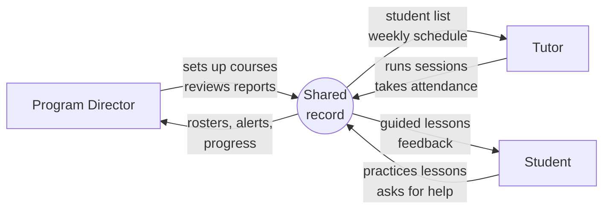
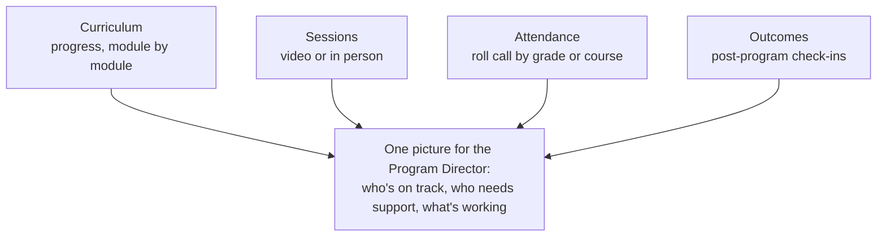

# Menya Tutoring

**Adaptive STEM tutoring infrastructure for nonprofit tutoring organizations.**

Menya gives program leadership a live, accurate picture of whether tutoring is working — who's showing up, who's improving, and who needs more support — instead of piecing it together after the fact. Tutors and students work inside that same system, so nothing about a student's progress falls through the cracks between sessions.

**See it live:** [floral-minus-74527153.figma.site](https://floral-minus-74527153.figma.site)

---

## Three roles, one shared system

**Program Director**
Oversees every student, tutor, and session from one place — who's on track, who needs support, and where a course still needs content, without waiting on a weekly email digest.

**Tutor**
Sees their students, their week, and who needs extra attention before logging in — books sessions, and takes attendance for a whole grade or class in a single roll call.

**Student**
Works through each course at their own pace — worked examples, practice problems, instant feedback — and can flag "I'm stuck" from inside any lesson to reach their tutor.

Each role gets its own view, but all three sit on top of the same shared record — nothing is re-entered or re-explained between them:

---

## What it keeps track of

**Curriculum** — Courses broken into chapters and modules, so progress reads module by module, not just a final grade.

**Sessions** — Every tutoring session in one place, whether it happens over video or in person.

**Attendance** — A roll call a tutor takes in seconds, rolled up into a report leadership can act on.

**Outcomes** — Where students land after the program — college, career, military — tracked with dated check-ins.

Four separate things day to day, but they all feed the same picture for leadership:

---

*This is a working prototype. The people, courses, and numbers shown inside it are illustrative, not real program data.*
