# Menya Database Schema

Relational schema derived from the prototype's TypeScript data model
(`Menya.prototype/src/types/index.ts`). The prototype itself only persists to
`localStorage`; this is what a real backend's schema would look like,
normalizing the arrays/nested objects in that model into tables and join
tables.

## Entity-Relationship Diagram

```mermaid
erDiagram
    USERS ||--o| STUDENTS : "has profile"
    USERS ||--o| TUTORS : "has profile"
    USERS ||--o{ ALUMNI : "assigned staff for"

    STUDENTS ||--o{ SESSIONS : attends
    TUTORS   ||--o{ SESSIONS : leads
    COURSES  ||--o{ SESSIONS : covers
    SESSIONS ||--o{ SESSION_ARTIFACTS : produces

    STUDENTS ||--o{ ENROLLMENTS : enrolls
    COURSES  ||--o{ ENROLLMENTS : "enrolled via"

    TUTORS  ||--o{ TUTOR_COURSES : prefers
    COURSES ||--o{ TUTOR_COURSES : "preferred by"
    TUTORS  ||--o{ TUTOR_GRADES : prefers

    COURSES  ||--o{ CHAPTERS : contains
    CHAPTERS ||--o{ MODULES : contains
    MODULES  ||--o{ PRACTICE_ITEMS : "exercises / worked example"
    CHAPTERS ||--o{ PRACTICE_ITEMS : "chapter test"

    STUDENTS ||--o{ HOMEWORK_ITEMS : "assigned to"
    TUTORS   ||--o{ HOMEWORK_ITEMS : assigns
    COURSES  ||--o{ HOMEWORK_ITEMS : "for course"

    STUDENTS ||--o{ AI_PROJECTS : "generated for"
    COURSES  ||--o{ AI_PROJECTS : "in course"

    STUDENTS ||--o| ALUMNI : "becomes (optional)"
    ALUMNI   ||--o{ ALUMNI_CHECK_INS : "tracked by"

    STUDENTS ||--o{ HELP_REQUESTS : raises
    COURSES  ||--o{ HELP_REQUESTS : "about course"
    CHAPTERS ||--o{ HELP_REQUESTS : "about chapter"

    USERS {
        int      id PK
        string   email UK
        string   password_hash
        string   role "program | tutor | student"
        boolean  is_admin "program role only; regular staff vs admin"
        string   name
        datetime created_at
    }

    STUDENTS {
        int      id PK
        int      user_id FK "nullable -> USERS.id"
        string   name
        int      grade
        string   location
        string   status "exceeding | on-track | needs-support | at-risk"
        int      progress "cached 0-100"
        int      streak "cached, days"
        int      session_count "cached"
        datetime created_at
    }

    TUTORS {
        int      id PK
        int      user_id FK "nullable -> USERS.id"
        string   first_name
        string   last_name
        text     description
        int      student_count "cached"
        int      session_count "cached"
        datetime created_at
    }

    TUTOR_COURSES {
        int tutor_id PK, FK
        int course_id PK, FK
    }

    TUTOR_GRADES {
        int tutor_id PK, FK
        int grade PK
    }

    COURSES {
        int    id PK
        string name UK
        string grade_range
        text   description
    }

    CHAPTERS {
        int    id PK
        int    course_id FK
        string title
        string difficulty "Beginner | Intermediate | Advanced"
        int    sort_order
    }

    MODULES {
        int    id PK
        int    chapter_id FK
        string title
        string status "not-started | in-progress | completed"
        text   description
        json   content "array of body text blocks"
        json   diagram "optional DiagramSpec"
        int    sort_order
    }

    PRACTICE_ITEMS {
        int    id PK
        int    module_id FK "nullable; set for exercises/worked example"
        int    chapter_id FK "nullable; set for chapter tests"
        string kind "worked_example | exercise | chapter_test"
        text   prompt
        text   answer
        string type "free-response | true-false | multiple-choice | numeric"
        json   choices "multiple-choice only"
        int    correct_index "multiple-choice/true-false"
        string numeric_answer
        text   hint
        json   diagram "optional DiagramSpec"
    }

    ENROLLMENTS {
        int      student_id PK, FK
        int      course_id PK, FK
        datetime enrolled_at
    }

    SESSIONS {
        int      id PK
        int      student_id FK
        int      tutor_id FK
        int      course_id FK
        date     scheduled_date
        string   scheduled_time
        int      duration_minutes
        string   status "upcoming | in-progress | scheduled | completed"
        string   type "tutoring | check-in"
        string   location "in-person | virtual"
        string   meeting_id "virtual only"
        string   meeting_password "virtual only"
        int      score "nullable; set once completed"
        datetime created_at
    }

    SESSION_ARTIFACTS {
        int    id PK
        int    session_id FK
        string type "notes | whiteboard"
        string label
        string url
    }

    HOMEWORK_ITEMS {
        int      id PK
        int      student_id FK
        int      course_id FK
        int      assigned_by_tutor_id FK
        string   title
        datetime assigned_at
        date     due_date
        string   status "not-started | in-progress | submitted"
        int      completion "0-100"
    }

    AI_PROJECTS {
        int      id PK
        int      student_id FK
        int      course_id FK
        string   module_title "denormalized reference into curriculum"
        string   title
        string   difficulty "Beginner | Intermediate | Advanced"
        int      estimated_mins
        string   status "pending | approved | revision | rejected"
        datetime generated_at
        text     ai_note
        json     tasks "array of task strings"
        datetime assigned_at
        date     due_date
        text     tutor_note
    }

    ALUMNI {
        int     id PK
        int     student_id FK "nullable; not every alumnus was a tracked student"
        string  name
        int     last_grade
        string  location
        string  exit_reason "graduated | left-program"
        int     exit_year
        boolean hs_graduated
        string  outcome "stem-college | non-stem-college | stem-career | non-stem-career | military | gap-year | unknown"
        string  verification "self-reported | verified"
        string  institution
        string  field_of_study
        date    last_contact
        string  follow_up_status "up-to-date | due-soon | overdue"
        int     assigned_staff_id FK "-> USERS.id"
        text    notes
        string  email
        string  phone
        string  linked_in
        boolean is_success_story
        text    testimonial
        boolean open_to_mentoring
    }

    ALUMNI_CHECK_INS {
        int    id PK
        int    alumni_id FK
        string timeframe
        date   date
        string outcome "same enum as ALUMNI.outcome"
        string verification "self-reported | verified"
        text   note
    }

    HELP_REQUESTS {
        int      id PK
        int      student_id FK
        int      course_id FK
        int      chapter_id FK
        int      module_index "position within chapter; modules aren't independently addressable today"
        text     note
        datetime created_at
        string   status "open | resolved"
        datetime resolved_at
    }
```

## Notes

- **Cached/denormalized columns** (`STUDENTS.progress/streak/session_count`,
  `TUTORS.student_count/session_count`) mirror fields the prototype stores
  directly rather than computing on read. A real backend could instead derive
  these with aggregate queries over `SESSIONS`; keeping them as columns is a
  read-performance tradeoff for dashboard-heavy pages, refreshed by triggers
  or a background job.
- **Enums** are written as string comments for portability; use native
  `ENUM`/`CHECK` constraints (Postgres) or a lookup table per enum, depending
  on the target database.
- **`PRACTICE_ITEMS`** unifies `PracticeItem` from three call sites in the
  TypeScript model (a module's worked example, a module's exercises, and a
  chapter's test) behind a `kind` discriminator, so exercise-authoring UI
  can query one table instead of three near-identical shapes.
- **`ALUMNI.student_id`** is nullable because the current model allows an
  alumni record with no link back to a tracked student (self-reported exits,
  historical data entered manually).
- **`MODULES`** has no natural id in the current TypeScript model (modules
  are addressed by array position within a chapter); this schema adds a
  surrogate `id` so `HELP_REQUESTS` and `PRACTICE_ITEMS` can reference a
  specific module directly instead of via `module_index`, except where
  `HELP_REQUESTS` still carries `module_index` to match today's app behavior.
