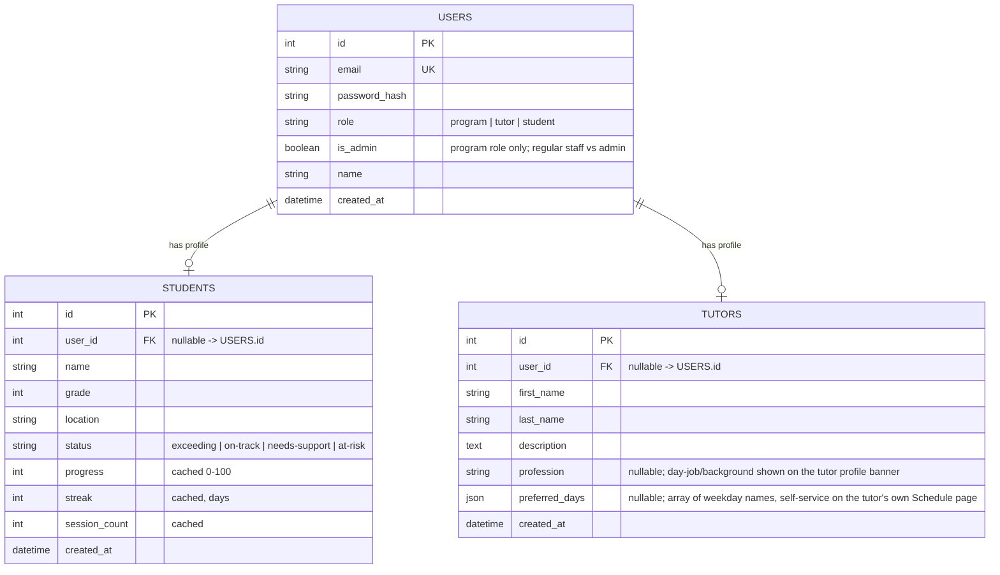
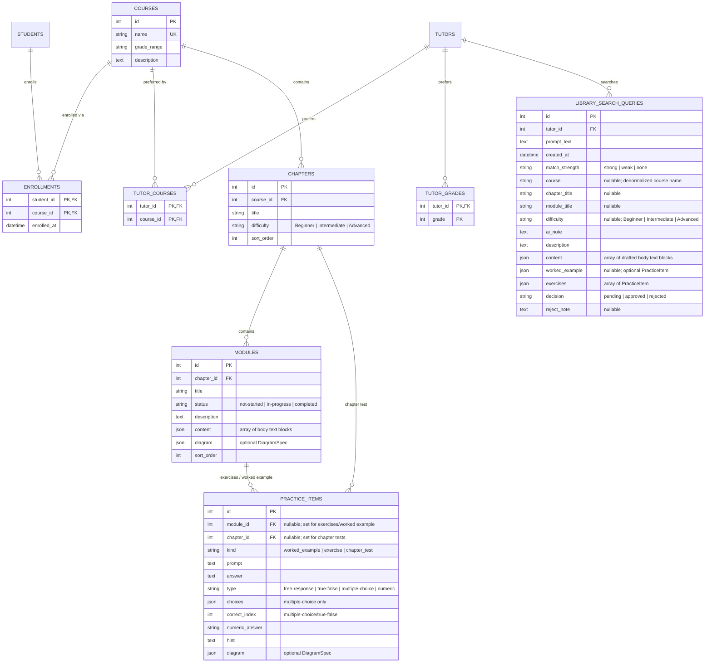
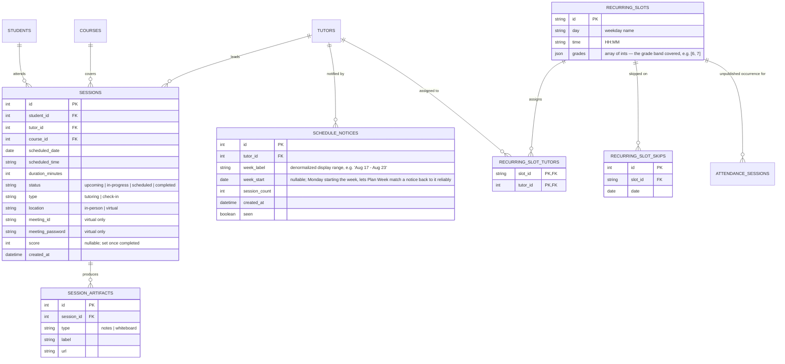
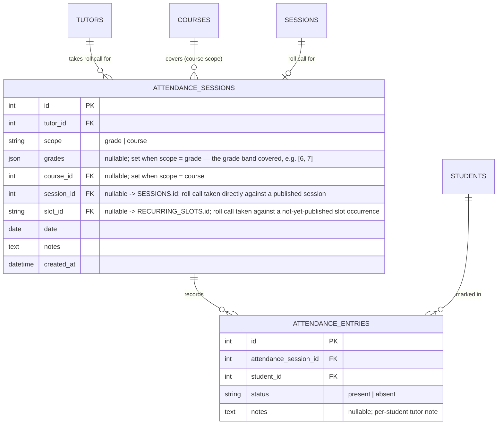
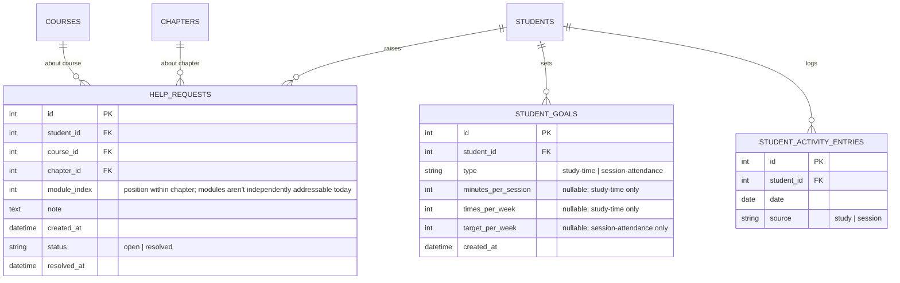
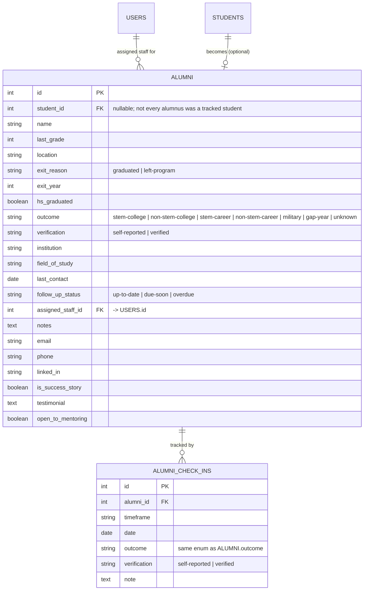

# Menya Database Schema

Relational schema derived from the prototype's TypeScript data model
(`Menya.prototype/src/types/index.ts`). The prototype itself only persists to
`localStorage`; this is what a real backend's schema would look like,
normalizing the arrays/nested objects in that model into tables and join
tables.

## Entity-Relationship Diagram

The full schema is 23 tables, too many to read as one diagram, so it's split
below into six subject-area diagrams that roughly track the feature areas in
the [top-level README](../../README.md). An entity is drawn with its full
columns in the diagram it "belongs" to, and as a plain box (name only, no
columns) anywhere else it's referenced, so you can still see how the areas
connect without repeating every column.

### Identity & Roles

`USERS` is the login/auth record; `STUDENTS` and `TUTORS` are role profiles
optionally linked back to one.

### Curriculum & Enrollment

The course/chapter/module library, students' course enrollment, tutors'
course/grade coverage preferences, and the AI-assisted curriculum search
tutors use to pull material into a session.

### Scheduling & Sessions

The standing weekly `RECURRING_SLOTS` template, the batch-publish flow that
turns a slot occurrence into a dated `SESSIONS` row (notifying tutors via
`SCHEDULE_NOTICES`), and what a session itself tracks.

### Attendance

Roll call: one `ATTENDANCE_SESSIONS` row per tutor-led group or 1:1
gathering, taken either against a published `SESSIONS` row or an
unpublished `RECURRING_SLOTS` occurrence, with a per-student
`ATTENDANCE_ENTRIES` mark underneath it.

### Student Engagement

A student's help requests to their tutor, self-set goals, and the daily
activity log that streaks and goal progress are computed from.

### Alumni & Outcomes

Post-program tracking: an optional link from a former student to their
`ALUMNI` record, the staff member assigned to follow up, and dated
`ALUMNI_CHECK_INS`.

## Notes

- **Cached/denormalized columns** (`STUDENTS.progress/streak/session_count`)
  mirror fields the prototype stores directly rather than computing on read.
  `progress`/`session_count` could be derived with aggregate queries over
  `SESSIONS`; `streak` is derived from `STUDENT_ACTIVITY_ENTRIES` instead — a
  broader daily log covering both self-study and session-attendance days, not
  just `SESSIONS` — since a streak should count a day the student studied on
  their own too. Keeping all three as columns is a read-performance tradeoff
  for dashboard-heavy pages, refreshed by triggers or a background job.
  `TUTORS` has no equivalent cached counts today — the prototype computes a
  tutor's caseload/session totals live from `SESSIONS` rather than storing
  them.
- **Enums** are written as string comments for portability; use native
  `ENUM`/`CHECK` constraints (Postgres) or a lookup table per enum, depending
  on the target database.
- **`PRACTICE_ITEMS`** unifies `PracticeItem` from three call sites in the
  TypeScript model (a module's worked example, a module's exercises, and a
  chapter's test) behind a `kind` discriminator, so exercise-authoring UI
  can query one table instead of three near-identical shapes.
- **`ALUMNI.student_id`** is nullable because the current model allows an
  alumni record with no link back to a tracked student (self-reported exits,
  historical data entered manually).
- **`MODULES`** has no natural id in the current TypeScript model (modules
  are addressed by array position within a chapter); this schema adds a
  surrogate `id` so `HELP_REQUESTS` and `PRACTICE_ITEMS` can reference a
  specific module directly instead of via `module_index`, except where
  `HELP_REQUESTS` still carries `module_index` to match today's app behavior.
- **`ATTENDANCE_SESSIONS`** represents one tutor-led roll call — an in-person
  group (grade band or course) or a single 1:1 online session — distinct from
  `SESSIONS`, which tracks the booking itself rather than who showed up.
  `grades` and `course_id` are mutually exclusive, set by `scope`, the same
  pattern as `SESSIONS.meeting_id`/`meeting_password` being set only for
  virtual sessions. `session_id` is set when the roll call is taken directly
  against a published `SESSIONS` row (the normal path — one card per session
  on the tutor's Attendance page); `slot_id` is set instead when it's taken
  against a `RECURRING_SLOTS` occurrence that hasn't been published as a real
  session yet (the "log a custom roll call" fallback path). Both are nullable
  and, in practice, mutually exclusive.
- **`ATTENDANCE_ENTRIES`** has no natural id in the current TypeScript model
  (an entry is just `{ student_id, status, notes? }` inside an
  `AttendanceSession`); this schema adds a surrogate `id` for the same reason
  as `MODULES` above, and a `(attendance_session_id, student_id)` unique
  constraint would enforce one mark per student per roll call. `notes` is a
  per-student comment a tutor can leave alongside the present/absent mark.
- **`SCHEDULE_NOTICES`** is created one-per-tutor when program staff publish a
  batch of `SESSIONS` for an upcoming week (the "Plan Week" flow), so a
  tutor's notification bell can say "N new sessions" without joining across
  every session in that batch. `week_label` stays denormalized display text
  (e.g. "Aug 17 - Aug 23") for rendering; `week_start` was added alongside it
  so the Plan Week page can reliably match a notice back to a specific week —
  `week_label` alone has no year and isn't sortable. `week_start` is nullable
  because notices created before that column existed predate it.
- **`RECURRING_SLOTS`** is a standing weekly template ("most in-person
  sessions land on the same recurring slot by grade band") — assigning a
  tutor via `RECURRING_SLOT_TUTORS` just sets who's expected on that slot; it
  only becomes a real dated `SESSIONS` row (and, from there, an
  `ATTENDANCE_SESSIONS` row) once program staff publish that week's
  occurrence. `id` is a natural/generated string key (e.g. `"Monday-6,7"`)
  rather than a surrogate int, matching the prototype's client-generated ids.
  `RECURRING_SLOT_SKIPS` records one cancelled projected occurrence (a
  specific date a tutor skipped) without deleting the standing slot itself —
  a `(slot_id, date)` unique constraint would enforce one skip per occurrence.
- **`STUDENT_GOALS`** holds a student's self-set commitment — either a
  self-study time goal or a session-attendance target. `minutes_per_session`/
  `times_per_week` and `target_per_week` are mutually exclusive, set by
  `type`, the same discriminated pattern as `ATTENDANCE_SESSIONS.grades`/
  `course_id`. Progress toward a goal is computed live from
  `STUDENT_ACTIVITY_ENTRIES`, not stored on the goal itself.
- **`STUDENT_ACTIVITY_ENTRIES`** is the source-of-truth daily log ("did this
  student study or attend a session today") that streaks, weekly goal
  progress, and achievements are all computed from — the real-data
  replacement for what used to be a static seeded streak. A
  `(student_id, date, source)` unique constraint would enforce at most one
  entry per source per day.
- **`LIBRARY_SEARCH_QUERIES`** logs a tutor's Curriculum Library search
  (prompt in, best-effort result out) along with their approve/reject
  decision on it. The result is stored as a denormalized blob — `content`,
  `worked_example`, `exercises` — the same simplification `MODULES.content`/
  `diagram` make, rather than normalizing a drafted-but-maybe-never-approved
  result into `PRACTICE_ITEMS`. A `"strong"` `match_strength` surfaces a real
  authored module (`course`/`chapter_title`/`module_title` populated); a
  `"weak"`/`"none"` match instead drafts new practice content and doubles as
  a library-gap signal, leaving those three columns null.
